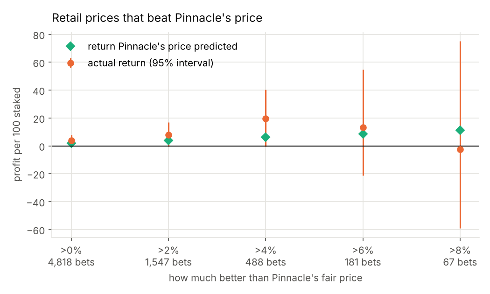
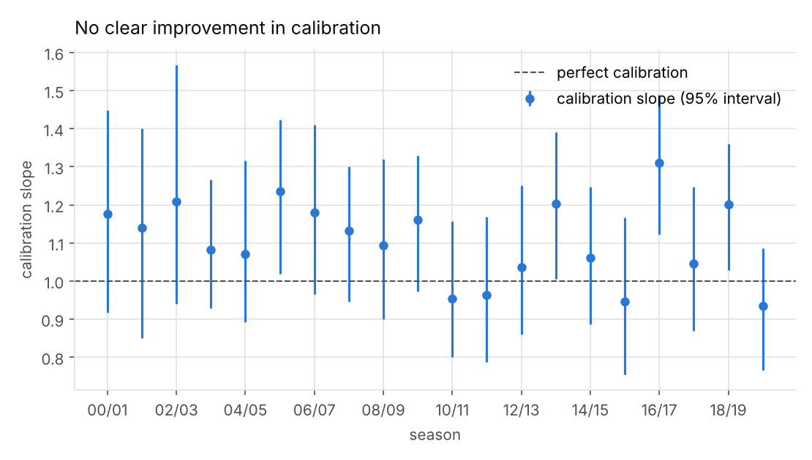
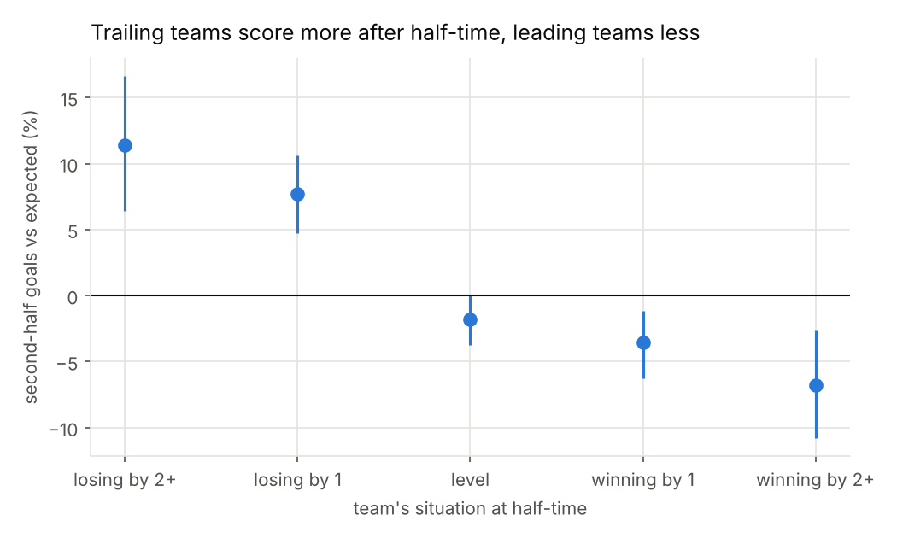

# Testing the Efficiency of Football Betting Odds

Bookmakers set odds on every professional football match. Odds can be read as
probabilities, so they are a forecast. This project tests that forecast on
16,670 English Premier League and Championship matches from 2000 to 2020.

If the market is efficient, outcomes happen as often as the odds say, and no
simple rule makes money after the bookmaker's margin.

**Main result.** The odds are close to calibrated, and a statistical model
built from past scores could not improve on them. The market has two
consistent weaknesses: long shots are overpriced, and the opening price lags
behind news that arrives before kick-off. Neither weakness has faded over
20 years.

Website: https://hughfod.github.io/soccer-markets/

> **Odds, briefly.** Decimal odds of 2.50 return £2.50 for every £1 staked,
> including the stake, and imply a probability of 1 ÷ 2.50 = 40%. The three
> probabilities for a match (home, draw, away) add up to slightly more than
> 100%. The excess is the bookmaker's margin.

## Findings

**1. The odds are close to calibrated.** Outcomes priced at 64% happened 67%
of the time; outcomes priced at 13% happened 12%. The calibration slope is
1.10 (95% interval 1.06–1.14), where 1 is perfect. A slope above 1 means
favourites win slightly more often than priced.


**2. Long shots are overpriced.** At the average bookmaker's price, betting on
every heavy favourite (odds 1–1.5) lost 2.0% per bet; betting on every long
shot (odds 10+) lost 22%. This favourite–long-shot bias is explained by how
the margin is loaded: assuming the margin sits mostly on long shots (the power
method) brings the calibration slope from 1.10 to 1.01.


**3. Margins have fallen by more than half,** from 13.0% in 2000/01 to 5.2%
in 2019/20. Pinnacle charges about 2.4%.


**4. Late price moves point the right way.** On 4,658 matches with Pinnacle
opening and closing odds (2015–2020), the closing odds were the better
forecast. When an outcome's probability rose by 3+ points before kick-off, a
bet at the opening odds returned +11.2% (95% interval +2.5% to +20.7%); when
it fell by 3+ points, −18.9%. This is not a strategy (the move is not known in
advance), but it shows that the opening price has not yet absorbed team news
and informed money.


**5. A model from past scores cannot beat the market.** A Poisson
attack/defence model (Dixon & Coles, 1997), refitted every week on earlier
matches only, scored log loss 1.039 against the market's 1.008 on 9,320 test
matches. Combining the two did not help (change +0.0002, interval −0.0004 to
+0.0009). Betting the model's "value" picks lost 6.7% per bet at average odds
and 3.6% at Pinnacle.


| Forecast (9,320 matches, 2010–2020) | Log loss | RPS |
|---|---|---|
| Equal chances (⅓ each) | 1.0986 | 0.2339 |
| Model from past scores | 1.0390 | 0.2122 |
| Betting market | 1.0083 | 0.2057 |
| Market + model combined | 1.0087 | 0.2057 |

**6. Pinnacle's price can find generous retail prices, but the evidence is
weak.** With the margin removed, Pinnacle (2.5% margin) and the average
bookmaker (5.6%) are equally accurate. Betting only the retail prices that beat
Pinnacle's fair price returned +3.8% per bet (95% interval −0.2% to +7.8%,
4,818 bets); requiring a 2% advantage gave +8.0% (−0.4% to +16.9%). Every
estimate is positive and close to what Pinnacle's price predicted, but every
interval touches zero, and most of the profit came in 2012–2014.



**7. Margins fell, but the long-shot bias did not.** Season by season, the
calibration slope has no clear trend (−0.04 per decade, standard error 0.04).



**8. The Championship is not priced less efficiently.** I expected the less-
watched second division to be easier to beat. Its calibration slope (1.06,
interval 0.99–1.13) is no further from 1 than the Premier League's (1.12), and
the model added nothing in either league.

**9. In-play: a half-time lead is less safe than a simple model thinks.** A
simple half-time price turns the pre-match odds into expected goals and
assumes the second half continues at the same rate (56% of goals come after
half-time). But teams losing by 2+ at half-time scored 11% more second-half
goals than expected, and teams winning by 2+ scored 7% fewer: the trailing
team attacks and the leading team defends. So the simple model overrates
leads. A narrow favourite leading by one at half-time was given a 76% chance
and won 73% of 3,398 matches; from level, draws happened 40% of the time
against 37% predicted. Adding the score effect, estimated on seasons before
2010, improved half-time forecasts on the 9,319 later matches (log-loss gain
0.0015, 95% interval 0.0006–0.0024). The data have no in-play odds, so this
shows what a naive in-play price gets wrong, not whether bookmakers do.



Full tables, with intervals for every number: `output/report.md` after a run.

## Method notes

- **No look-ahead.** The model predicts each week from matches strictly before
  it. Its one setting (how fast old results fade) was chosen on seasons before
  2008 and never tuned on the test seasons. A test checks both.
- **Honest uncertainty.** Every return and calibration figure has a bootstrap
  95% interval that resamples whole matches, since a match's three outcomes
  are linked.
- **Three margin-removal methods** (proportional, power, Shin 1993) are
  compared rather than assuming one.
- **Several thresholds** are reported for the line-move test, so one lucky
  cut-off cannot carry the result.

## Limits

- The included data are English leagues to 2020. `step2_download_more_data.py`
  adds Spain, Germany, Italy and France and every season since, including
  2020/21, when matches were played without crowds (the analysis of home
  advantage without crowds runs automatically once that season is present).
- Odds are snapshots collected by football-data.co.uk, not every available price.
- "Best odds" across ten bookmakers is an upper bound: it needs an account at
  each, and the best price is sometimes a mistake that would be cancelled.
- This is a study of forecasting, not betting advice.

## Running it

In PyCharm, open each file and click the green ▶ next to `if __name__ == "__main__":`

| File | What it does |
|---|---|
| `step1_setup.py` | creates `.venv` and installs everything (once) |
| `step2_download_more_data.py` | optional: more leagues and seasons from football-data.co.uk |
| `step3_run_analysis.py` | runs everything (about a minute); results in `output/` |
| `step4_run_tests.py` | tests: margin maths, calibration, no look-ahead, the retail-vs-Pinnacle rule |
| `step5_build_website.py` | rebuilds `docs/index.html` |

From a terminal: `pip install -r requirements.txt && python run.py && python -m pytest`

## Layout

```
markets/data.py        load football-data.co.uk files into one table; downloader
markets/margin.py      odds to probabilities: proportional, power, Shin
markets/efficiency.py  scores, calibration, returns, line moves, bootstrap intervals
markets/model.py       walk-forward Poisson ratings model
markets/sharp.py       Pinnacle vs retail bookmakers, by season, by league
markets/live.py        half-time scores: a simple in-play model and score effects
markets/report.py      runs every analysis; charts, results.json, report.md
markets/website.py     builds the website from results.json
tests/                 nine checks
data/raw/              match files (football-data.co.uk)
```

Data: [football-data.co.uk](https://www.football-data.co.uk). The included
files come from the public mirror at github.com/jokecamp/FootballData.
