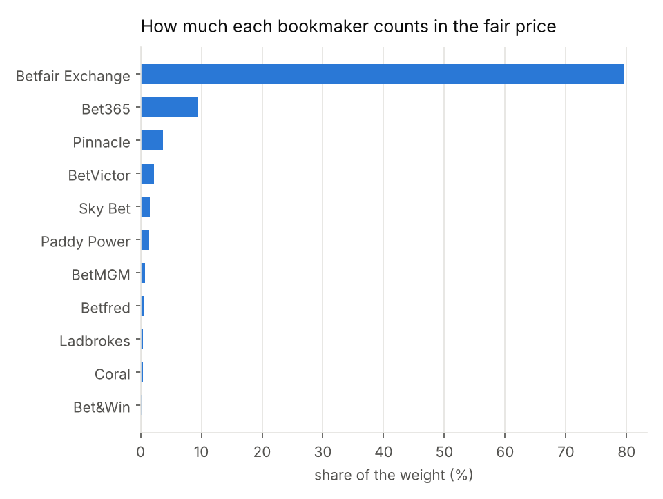
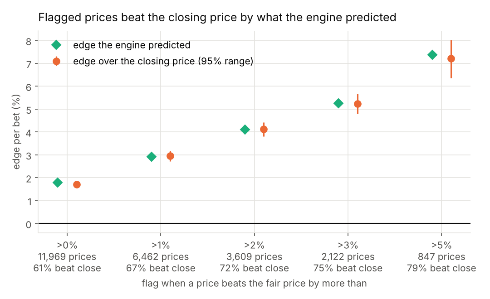
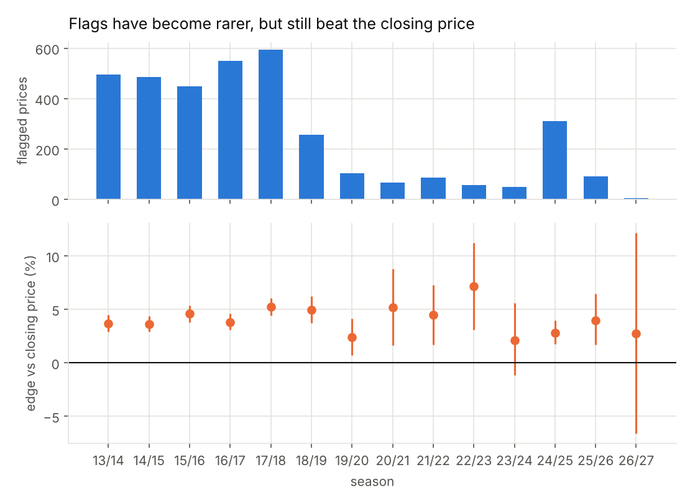
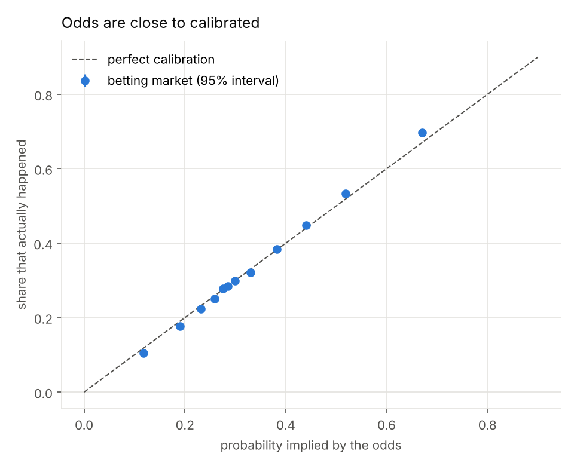
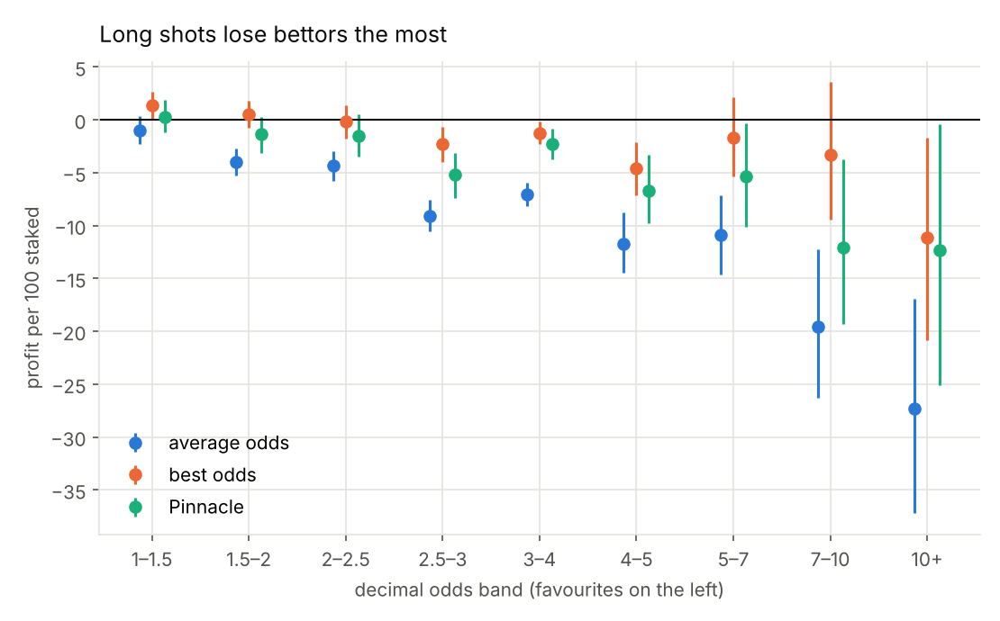
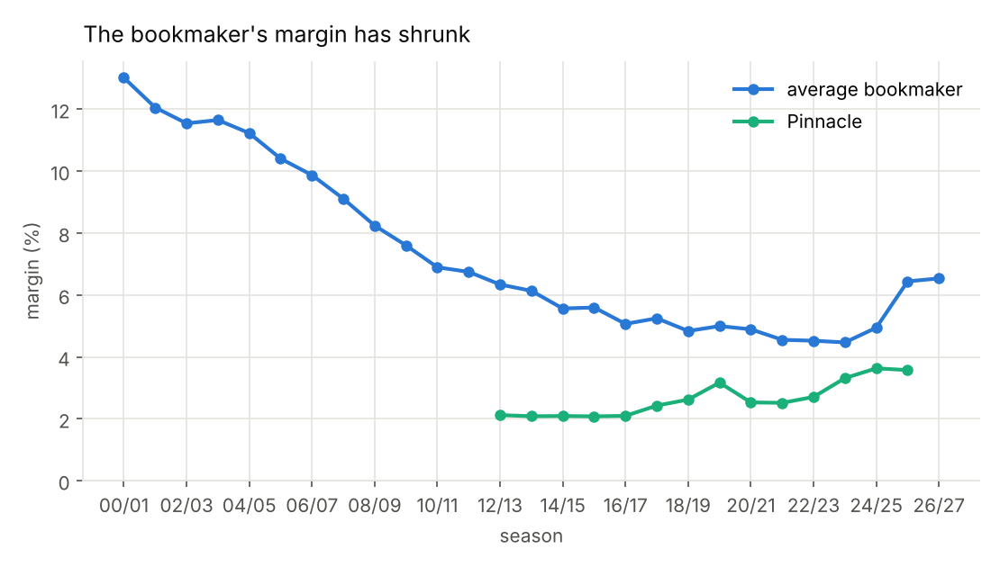
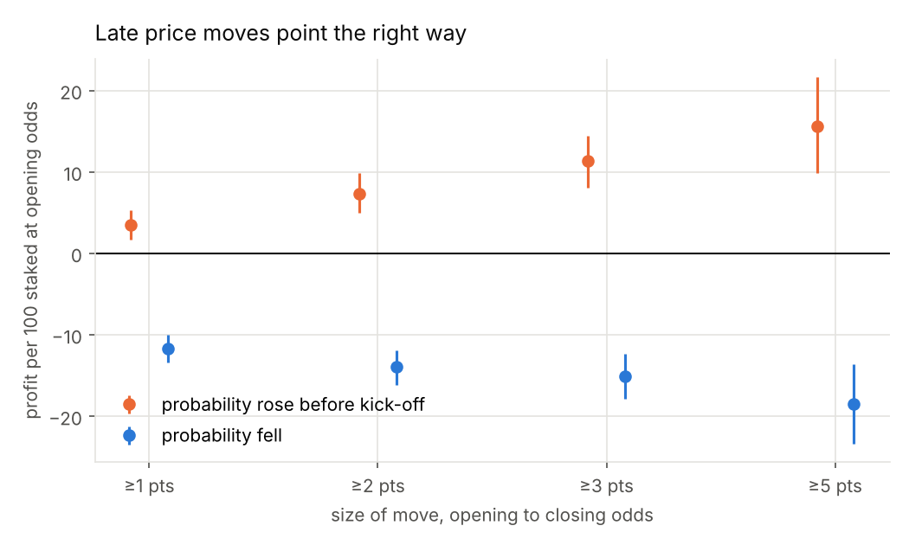
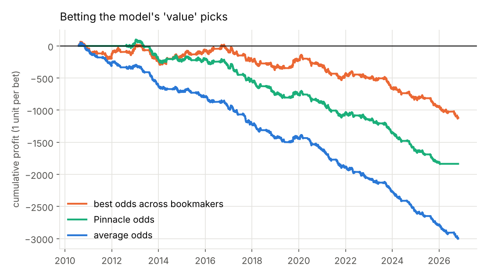
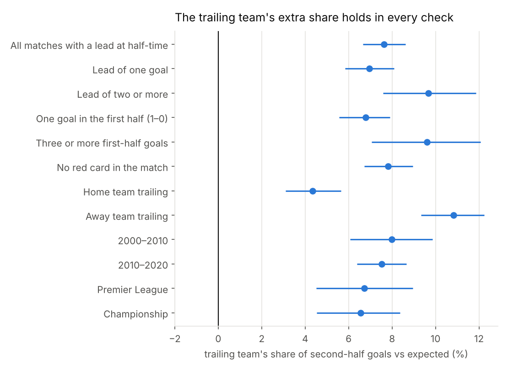

# A Fair-Price Engine for Football Odds

Bookmakers often disagree about the same match. This tool combines about ten
of them into one fair price for every upcoming game, then flags any bookmaker
whose odds are better than fair. It is built the way a market maker thinks:
work out what something is really worth, then look for prices that are out of
line.

**Main result.** When the engine flagged a price as more than 2% better than
fair, that price beat the market's closing price 72% of the time, by
4.1% on average (95% range 3.8% to 4.4%). That is almost exactly the
4.1% the engine predicted, tested on 30,976 matches (2013–2027) it had never seen.

- Website: https://hughfod.github.io/soccer-markets/
- This week's prices: https://hughfod.github.io/soccer-markets/this-week.html

> **How odds work.** Odds of 2.50 pay £2.50 for every £1 bet, including your
> stake. That implies a 40% chance (1 ÷ 2.50). The chances for a home win, a
> draw and an away win add up to a little over 100%. The extra is the
> bookmaker's cut, called the margin.

## How it works

1. **Remove each bookmaker's cut.** Every bookmaker's odds are turned into
   fair chances, taking more of the margin off long shots, where bookmakers
   put most of it.
2. **Blend the bookmakers.** The chances are combined into one fair price (a
   weighted logarithmic pool). Each bookmaker's weight is learned from how well
   its prices predicted the sharpest closing price in the previous two seasons.
   Today the blend is Betfair Exchange 79%, Bet365 9%, Pinnacle 4%, BetVictor 2%.
3. **Flag out-of-line prices.** Any regular bookmaker offering odds more than
   2% better than the fair price is flagged.

In 2026/27 the data stopped including Pinnacle, so the engine now learns from
and is tested against the Betfair Exchange closing price, the sharpest price
left.

Why learn from closing prices and not results? Results are mostly luck. My
first version learned from results, and its weights were unstable and worse
than using Pinnacle alone. The closing price, set just before kick-off, is the
market's final and best-informed view, so it is a much cleaner target.



## Track record

Profit is a poor test of a price because it depends on who won. The standard
test is the closing price: if you regularly get better odds than the market's
final price, your prices were genuinely good, whoever won.



| Flag when the price is | Prices | Predicted edge | Edge vs closing price (95% range) | Beat close |
|---|---|---|---|---|
| More than 0% better | 11,969 | +1.8% | +1.7% (+1.6% to +1.9%) | 61% |
| More than 1% better | 6,462 | +2.9% | +3.0% (+2.7% to +3.2%) | 67% |
| More than 2% better | 3,609 | +4.1% | +4.1% (+3.8% to +4.4%) | 72% |
| More than 3% better | 2,122 | +5.3% | +5.2% (+4.8% to +5.7%) | 75% |
| More than 5% better | 847 | +7.4% | +7.2% (+6.4% to +8.0%) | 79% |

The fair price is also closer to the closing price than any single bookmaker:

| Price | Distance to closing price | vs this engine |
|---|---|---|
| Fair price (this engine) | 0.00253 | +0% |
| Equal-weight average | 0.00265 | +5% |
| Pinnacle alone | 0.00255 | +1% |
| Bet365 alone | 0.00288 | +14% |

**The edge has shrunk.** Up to 2018/19 the engine flagged about 472 prices a season. Since then, as bookmakers have copied the sharpest prices faster, it has flagged about 97 a season. Those that remain still beat the closing price by 3.6% on average. Single seasons are noisy with so few flags (the weakest, 2023/24, was 2.1%), but the edge has held up in every one. On today's prices this is a tool for spotting the occasional mistake, not a steady stream of them.



The profit on the 2% flags was +7.2% per bet, but its 95% range
(+1.5% to +12.8%) is wide, which is why the closing price is the better test.
In practice, bookmakers limit customers who consistently beat their prices.

## What 27 seasons of odds show

Before building the engine, I studied how accurate the odds are, using
52,841 matches from the Bundesliga, English Premier League, English Championship, Ligue 1, Serie A and La Liga. These findings explain the design.

1. **The odds are accurate, but slightly too cautious.** Calibration slope
   1.10 (1.00 is perfect): favourites win a little more often than
   the odds say. 
2. **Long shots are a bad bet.** £1 on every heavy favourite lost
   1p; £1 on every long shot (odds of 10 or more) lost 27p. Bookmakers put more
   of their margin on long shots, which is why the engine removes it that way.
   
3. **Bookmakers take a smaller cut than they used to,** from
   13.0% to 6.5%. 
4. **Prices that move before kick-off move the right way,** so the closing
   price knows more than the opening one. When a chance rose 3+ points before
   kick-off, a bet at the opening price made +11.3%. This is why the engine is
   judged against the closing price. 
5. **A model built from past results can't beat the odds.** Team ratings
   refitted every week scored log loss 1.016 against the odds' 0.986, and adding the
   model to the odds didn't help. The engine therefore starts from the odds,
   not from a model. 
6. **After half-time, the team that's behind scores more than expected.**
   Within the same match, the trailing team scored 47.0% of second-half goals
   against 43.7% expected, and the pattern holds in all 12 checks. A
   simple live price that ignores this overrates the team in front.
   

Full tables with 95% ranges for every number are in `output/report.md` after a run.

## Running it

In PyCharm, open `update_everything.py` and click the green ▶ next to
`if __name__ == "__main__":`. It sets up the first time, downloads the latest
odds, reruns everything, prices this week's matches and rebuilds the website
and this README. Run `step6_this_week.py` on its own to refresh just this
week's prices.

From a terminal: `pip install -r requirements.txt && python update_everything.py && python -m pytest`

## Layout

```
markets/fairprice.py   the engine: margin removal, weighted pool, weights from closing prices, flags, backtest
markets/weekly.py      prices this week's matches -> docs/this-week.html
markets/data.py        loads and downloads football-data.co.uk files
markets/margin.py      odds to fair chances: proportional, power, Shin
markets/efficiency.py  scores, calibration, returns, bootstrap ranges
markets/model.py       team-ratings model (the baseline the odds beat)
markets/sharp.py       Pinnacle vs other bookmakers, by season, by league
markets/live.py        half-time scores and score effects
markets/report.py      runs every analysis; charts, results.json, report.md
markets/website.py     builds the website; markets/readme.py builds this README
tests/                 fourteen checks, including that nothing is fitted on the matches it is tested on
```

## Limits

- The track record needs closing prices, which the data has from 2015/16.
- Odds are snapshots collected twice a week by football-data.co.uk, so a
  flagged price may already have moved.
- This is a study of pricing, not betting advice.

Data: [football-data.co.uk](https://www.football-data.co.uk).
